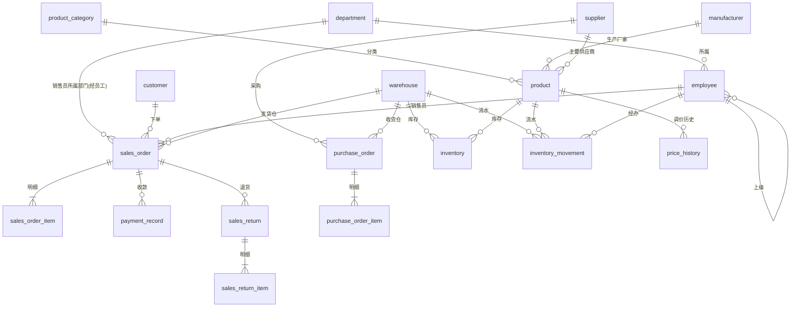

# medsalesdb 数据库结构分析报告

> 分析对象：`demo-db` 容器（PostgreSQL 17）中的 `medsalesdb` 数据库
> 分析日期：2026-09-01
> 分析方法：导出完整 schema（18 张表 + 7 个视图 + 索引/约束），并对各表数据量、字段取值分布、示例数据做了抽样核对
>
> 说明：本报告所述的结构与数据已由本仓库的建库/造数脚本固化——DDL 见
> [`db/schema.sql`](../db/schema.sql)，数据生成与校验见
> [`db/generate_mock_data.py`](../db/generate_mock_data.py)、
> [`db/verify_database.py`](../db/verify_database.py)，参数集中在
> [`db/mock_params.py`](../db/mock_params.py)（用法见 [db/README.md](../db/README.md)）。

---

## 1. 数据库概述

### 1.1 基本信息

| 项目 | 内容 |
| --- | --- |
| 数据库名 | medsalesdb |
| 数据库版本 | PostgreSQL 17.10 |
| 编码 | UTF8 / zh_CN.utf8 |
| 表数量 | 18 张业务表 |
| 视图数量 | 7 个（销售/库存/客户/员工/商品汇总视图） |
| 业务类型 | 医药（疫苗、药品、医疗器械）销售/流通公司业务系统 |

### 1.2 数据规模

| 表 | 中文含义 | 行数 |
| --- | --- | --- |
| inventory_movement | 库存流水 | 1,860,391 |
| sales_order_item | 销售订单明细 | 1,621,651 |
| sales_order | 销售订单主表 | 212,585 |
| purchase_order | 采购订单主表 | 217,525 |
| purchase_order_item | 采购订单明细 | 317,832 |
| payment_record | 收款记录 | 196,687 |
| customer | 客户档案 | 1,650 |
| inventory | 当前库存 | 3,204 |
| employee | 员工档案 | 500 |
| product | 商品档案 | 365 |
| price_history | 价格调整历史 | 1,285 |
| sales_return | 销售退货单 | 5,040 |
| sales_return_item | 销售退货明细 | 7,015 |
| manufacturer | 生产厂家 | 148 |
| supplier | 供应商 | 37 |
| department | 部门 | 20 |
| warehouse | 仓库 | 9 |
| product_category | 商品分类 | 7 |

### 1.3 数据时间范围

- 业务单据（销售/采购/库存流水/收款）：2022-01-01 ～ 2026-07-31，约 4 年半的连续经营数据；
- 客户建档时间：2017-01-01 ～ 2021-12-27，说明客户档案从 2017 年开始积累；
- 库存以 2022-01-01 为期初建账日（存在 3,204 条"期初入库"流水）。

---

## 2. 业务画像推断

从表结构、字段注释和实际数据可以推断，这是一个**医药销售（分销）公司**的业务后台，经营**疫苗、化学药品、生物制品、中成药、高值/低值耗材、医疗设备**的批发与配送：

- **下游客户**：三级/二级医院、基层医疗机构、民营医院、疾控中心、连锁药房、单体药房、诊所、经销商等 1,650 家；
- **上游供应商**：以生产企业为主（北京科兴、华兰生物、智飞生物、默沙东、GSK 等）37 家；
- **经营规模**：9 大区域仓库、500 名员工、20 个部门（总部职能 + 9 大区域销售部）；
- **业务特征**：明显具备 GSP（药品经营质量管理规范）行业特征：
  - 商品有批准文号、剂型、储存条件、冷链标识、效期（shelf_life_months）；
  - 仓库区分冷链库（has_cold_chain），配送区分冷链/常温；
  - 退货原因包含"冷链断链""效期临近""质量问题"等。

---

## 3. 实体关系概览

### 3.1 关系总览



### 3.2 核心业务链路

```
供应商 ──采购单──> 采购入库 ──> 库存 ──> 销售出库 ──> 客户
  ▲                                      │
  └──────────── 采购付款 ────────────────┤
                                         ▼
                              客户收款 (payment_record)
                                         ▲
                                         │
                             退货入库 ◄──退货单── 客户
```

库存流水（inventory_movement）通过 `ref_table` + `ref_id` 与三类单据明细关联：`sales_order_item`（销售出库）、`purchase_order_item`（采购入库）、`sales_return_item`（退货入库），是连接进销存的主线索。

---

## 4. 各模块表结构详述

### 4.1 组织架构与人员

#### department 部门表（20 行）

记录公司组织架构：总经办 + 销售管理部 + 9 大区域销售部（华东/华南/华北/华中/河南/山东/西南/西北/东北）+ 采购部、仓储物流部、质量部、财务部、市场部、售后服务部、信息技术部、行政人事部、合规部。

| 字段 | 类型 | 说明 |
| --- | --- | --- |
| id | integer PK | 部门主键 |
| code | varchar(20) UNIQUE | 部门编码（D000/D001/D101...） |
| name | varchar(50) | 部门名称 |
| description | varchar(200) | 职责说明 |
| created_at | timestamp | 创建时间 |

#### employee 员工表（500 行）

| 字段 | 类型 | 说明 |
| --- | --- | --- |
| id | integer PK | 员工主键 |
| code | varchar(20) UNIQUE | 工号（E0001...） |
| name | varchar(50) | 姓名 |
| gender | varchar(10) | 性别 |
| phone / email | varchar | 联系方式 |
| department_id | integer FK→department | 所属部门 |
| position | varchar(50) | 职位（总经理/销售代表/高级销售代表...） |
| manager_id | integer FK→employee | 直属上级（自引用，形成汇报关系） |
| hire_date | date | 入职日期 |
| employment_status | varchar(20) | 在职/离职 |
| created_at | timestamp | 创建时间 |

---

### 4.2 主数据

#### customer 客户表（1,650 行）

客户是销售系统的核心主数据，覆盖医院、疾控、药房、诊所、经销商等全渠道客户。

| 字段 | 类型 | 说明 |
| --- | --- | --- |
| id | integer PK | 客户主键 |
| code | varchar(20) UNIQUE | 客户编码（C00001...） |
| name | varchar(100) | 客户全称 |
| customer_type | varchar(30) | 类型：三级医院/二级医院/基层医疗机构/民营医院/疾控中心/连锁药房/单体药房/诊所/经销商/其他机构 |
| coop_level | varchar(20) | 合作等级：战略合作/重点客户/普通客户/新客户 |
| contact_person / phone / email | varchar | 采购联系人信息 |
| province / city / address | varchar | 区域与收货地址 |
| license_no | varchar(50) | 医疗机构执业许可证/药品经营许可证/营业执照编号 |
| credit_limit | numeric(14,2) | 信用额度（赊销上限，默认 0） |
| status | varchar(20) | 正常/冻结/流失/暂停合作 |
| remark | varchar(200) | 备注 |
| created_at | timestamp | 建档时间 |

实际数据分布：单体药房 480、基层医疗机构 320、二级医院 260、民营医院 140、经销商 120、三级医院 110、连锁药房 90、其他机构 70、疾控中心 60。

#### supplier 供应商表（37 行）

| 字段 | 类型 | 说明 |
| --- | --- | --- |
| id | integer PK | 供应商主键 |
| code | varchar(20) UNIQUE | 编码（SUP001...） |
| name | varchar(100) | 全称 |
| contact_person / phone / email | varchar | 业务联系人 |
| province / city / address | varchar | 区域地址 |
| credit_days | smallint | 结算账期天数（30/45 天） |
| status | varchar(20) | 合作中/暂停合作/已终止 |
| created_at | timestamp | 创建时间 |

#### manufacturer 生产厂家表（148 行）

| 字段 | 类型 | 说明 |
| --- | --- | --- |
| id | integer PK | 厂家主键 |
| name | varchar(100) UNIQUE | 厂家名称 |
| country | varchar(50) | 国家/地区 |
| description | varchar(200) | 简介 |
| created_at | timestamp | 创建时间 |

#### product_category 商品分类表（7 行）

一级分类：疫苗（CAT-VAC）、化学药品（CAT-DRUG）、生物制品（CAT-BIO）、中成药（CAT-TCM）、高值耗材（CAT-HIGH）、低值耗材（CAT-LOW）、医疗设备（CAT-EQUIP）。

| 字段 | 类型 | 说明 |
| --- | --- | --- |
| id | integer PK | 分类主键 |
| code | varchar(20) UNIQUE | 分类编码 |
| name | varchar(50) | 分类名称 |
| description | varchar(200) | 说明 |
| sort_order | smallint | 显示顺序 |
| is_active | boolean | 启用/停用 |
| created_at | timestamp | 创建时间 |

#### product 商品表（365 行）

| 字段 | 类型 | 说明 |
| --- | --- | --- |
| id | integer PK | 商品主键 |
| sku | varchar(30) UNIQUE | SKU 编码 |
| name | varchar(200) | 商品名称 |
| category_id | integer FK→product_category | 分类 |
| manufacturer_id | integer FK→manufacturer | 生产厂家 |
| supplier_id | integer FK→supplier | 主要供应商 |
| approval_no | varchar(60) | 批准文号/注册证号 |
| specification | varchar(100) | 规格（0.5ml/支、100mg*28片/盒） |
| unit | varchar(20) | 单位（支/盒/套/台） |
| dosage_form | varchar(30) | 剂型 |
| storage_condition | varchar(30) | 常温/阴凉/冷藏 2~8℃/冷冻 |
| is_cold_chain | boolean | 是否需冷链运输 |
| shelf_life_months | smallint | 有效期（月） |
| cost_price | numeric(14,2) | 采购成本价 |
| standard_price | numeric(14,2) | 挂网价/标准售价 |
| is_active | boolean | 在售/下架 |
| listed_date | date | 上市/挂网日期 |
| created_at | timestamp | 创建时间 |

商品按分类分布：化学药品 127、高值耗材 74、低值耗材 54、中成药 34、医疗设备 34、疫苗 24、生物制品 18。医疗设备单价高达数百万元，疫苗与耗材是走量主力。

#### price_history 价格调整历史表（1,285 行）

记录商品售价的历次调整，调整原因含"国家集采中标价调整/挂网价调整/促销让利"。

| 字段 | 类型 | 说明 |
| --- | --- | --- |
| id | integer PK | 主键 |
| product_id | integer FK→product | 商品 |
| effective_date | date | 调价生效日期 |
| old_price | numeric(14,2) | 调整前售价 |
| new_price | numeric(14,2) | 调整后售价 |
| change_reason | varchar(100) | 调价原因 |
| created_at | timestamp | 创建时间 |

#### warehouse 仓库表（9 行）

全国 9 大区域中心仓（上海/广州/北京/武汉/郑州/济南/成都/西安/沈阳），均具备冷链库。

| 字段 | 类型 | 说明 |
| --- | --- | --- |
| id | integer PK | 仓库主键 |
| code | varchar(20) UNIQUE | 仓库编码（WH-EST...） |
| name | varchar(100) | 仓库名称 |
| province / city / address | varchar | 区域地址 |
| manager_name / phone | varchar | 仓管负责人 |
| has_cold_chain | boolean | 是否具备 2~8℃ 冷链库 |
| status | varchar(20) | 正常/停用 |
| created_at | timestamp | 创建时间 |

---

### 4.3 采购管理

#### purchase_order 采购订单主表（217,525 行）

| 字段 | 类型 | 说明 |
| --- | --- | --- |
| id | bigint PK | 采购单主键 |
| order_no | varchar(30) UNIQUE | 编号，格式 PO+日期+序号 |
| supplier_id | integer FK→supplier | 供应商 |
| warehouse_id | integer FK→warehouse | 收货仓库 |
| order_date | date | 下单日期 |
| expected_date | date | 预计到货日期 |
| received_date | date | 实际到货日期 |
| status | varchar(20) | 待收货/部分收货/已完成 |
| total_amount | numeric(14,2) | 采购总金额 |
| delivery_type | varchar(30) | 冷链运输/常温运输 |
| remark | varchar(200) | 备注 |
| created_at | timestamp | 创建时间 |

实际状态分布：已完成 188,499、部分收货 28,936、待收货 90。

#### purchase_order_item 采购订单明细表（317,832 行）

| 字段 | 类型 | 说明 |
| --- | --- | --- |
| id | bigint PK | 明细主键 |
| purchase_order_id | bigint FK→purchase_order | 所属采购单 |
| product_id | integer FK→product | 商品 |
| quantity | integer CHECK > 0 | 采购数量 |
| unit_cost | numeric(14,2) | 采购单价 |
| amount | numeric(14,2) | 采购金额 |
| received_quantity | integer | 实收数量（0 表示未收货） |
| received_date | date | 实收日期 |

采购单支持**分批/部分收货**（明细行记录实收数量与实收日期）。

---

### 4.4 销售管理

#### sales_order 销售订单主表（212,585 行）

| 字段 | 类型 | 说明 |
| --- | --- | --- |
| id | bigint PK | 订单主键 |
| order_no | varchar(30) UNIQUE | 编号，格式 SO+日期+序号 |
| customer_id | integer FK→customer | 客户 |
| employee_id | integer FK→employee | 销售员 |
| warehouse_id | integer FK→warehouse | 发货仓库 |
| order_date | date | 下单日期 |
| status | varchar(20) | 待付款/已发货/已完成/已取消 |
| item_count | integer | 商品行数 |
| total_quantity | integer | 商品总数量 |
| subtotal_amount | numeric(14,2) | 小计金额 |
| discount_amount | numeric(14,2) | 优惠金额（行折扣+订单返利） |
| total_amount | numeric(14,2) | 应收金额 = 小计 - 优惠 |
| paid_amount | numeric(14,2) | 已收金额 |
| cost_amount | numeric(14,2) | 订单成本合计（用于毛利分析） |
| shipping_address | varchar(300) | 收货地址 |
| invoice_type | varchar(30) | 增值税专用发票/增值税普通发票/不开发票 |
| settlement_method | varchar(30) | 现款/月结30天/月结45天/月结60天/月结90天 |
| delivery_type | varchar(30) | 冷链运输/常温运输/快递配送/客户自提 |
| delivery_date | date | 发货日期 |
| remark | varchar(200) | 备注 |
| created_at | timestamp | 创建时间 |

实际状态分布：已完成 196,687、已取消 10,700、已发货 4,419、待付款 779。结算方式分布：月结30天 79,364、现款 53,548、月结60天 33,637、月结45天 26,709、月结90天 19,327。

#### sales_order_item 销售订单明细表（1,621,651 行）

| 字段 | 类型 | 说明 |
| --- | --- | --- |
| id | bigint PK | 明细主键 |
| sales_order_id | bigint FK→sales_order | 所属订单 |
| product_id | integer FK→product | 商品 |
| quantity | integer CHECK > 0 | 销售数量 |
| unit_price | numeric(14,2) | 成交单价（按当日挂网价与折扣） |
| unit_cost | numeric(14,2) | 成本单价快照 |
| discount_rate | numeric(5,4) | 行折扣率 |
| discount_amount | numeric(14,2) | 行优惠金额 |
| amount | numeric(14,2) | 行实付金额 = 单价×数量 - 行优惠 |

**关键设计**：订单行同时保存成交价和成本价快照，保证历史毛利核算不随商品档案价格变化而漂移。

---

### 4.5 库存管理

#### inventory 库存表（3,204 行）

| 字段 | 类型 | 说明 |
| --- | --- | --- |
| id | integer PK | 库存记录主键 |
| warehouse_id | integer FK→warehouse | 仓库 |
| product_id | integer FK→product | 商品 |
| quantity | integer CHECK ≥ 0 | 当前库存数量 |
| safety_stock | integer | 安全库存下限 |
| updated_at | timestamp | 最近更新时间 |

约束：`(warehouse_id, product_id)` 唯一，即一仓一品一条库存记录。

#### inventory_movement 库存流水表（1,860,391 行）

| 字段 | 类型 | 说明 |
| --- | --- | --- |
| id | bigint PK | 流水主键 |
| warehouse_id | integer FK→warehouse | 仓库 |
| product_id | integer FK→product | 商品 |
| movement_type | varchar(20) | 期初入库/采购入库/销售出库/退货入库 |
| quantity | integer CHECK ≠ 0 | 变动数量，正数入库、负数出库 |
| movement_date | date | 变动日期 |
| ref_table | varchar(40) | 关联单据表名 |
| ref_id | bigint | 关联单据明细 ID |
| created_by | integer FK→employee | 经办员工 |
| remark | varchar(200) | 备注（常为单据编号） |
| created_at | timestamp | 创建时间 |

流水类型分布：销售出库 1,533,317、采购入库 317,742、退货入库 6,198、期初入库 3,204。流水与单据明细的对应关系清晰（ref_table + ref_id），可完整追溯每一笔库存变动来源。

---

### 4.6 销售退货管理

#### sales_return 销售退货单表（5,040 行）

| 字段 | 类型 | 说明 |
| --- | --- | --- |
| id | bigint PK | 退货单主键 |
| return_no | varchar(30) UNIQUE | 编号，格式 RT+日期+序号 |
| sales_order_id | bigint FK→sales_order | 原销售订单 |
| customer_id | integer FK→customer | 客户 |
| warehouse_id | integer FK→warehouse | 退回仓库 |
| return_date | date | 退货日期 |
| status | varchar(20) | 待处理/已完成 |
| reason | varchar(100) | 退货原因 |
| total_amount | numeric(14,2) | 退货退款金额 |
| remark | varchar(200) | 备注（常为原订单编号） |
| created_at | timestamp | 创建时间 |

实际原因分布：部分商品退货 1,975、质量问题 565、冷链断链 529、发错货 519、滞销退货 494、效期临近 487、医院退回 471。

#### sales_return_item 销售退货明细表（7,015 行）

| 字段 | 类型 | 说明 |
| --- | --- | --- |
| id | bigint PK | 明细主键 |
| sales_return_id | bigint FK→sales_return | 所属退货单 |
| product_id | integer FK→product | 商品 |
| quantity | integer CHECK > 0 | 退货数量 |
| unit_price | numeric(14,2) | 退货单价（按原订单成交价） |
| amount | numeric(14,2) | 退货金额 |
| reason | varchar(100) | 行级退货原因 |

---

### 4.7 财务与收款

#### payment_record 收款记录表（196,687 行）

| 字段 | 类型 | 说明 |
| --- | --- | --- |
| id | bigint PK | 收款记录主键 |
| sales_order_id | bigint FK→sales_order | 关联订单 |
| customer_id | integer FK→customer | 付款客户 |
| payment_date | date | 付款日期 |
| amount | numeric(14,2) CHECK > 0 | 付款金额 |
| payment_method | varchar(20) | 银行转账/对公转账/承兑汇票/现金/网上银行 |
| status | varchar(20) | 成功/失败/冲正 |
| remark | varchar(200) | 备注（常为订单编号） |
| created_at | timestamp | 创建时间 |

收款方式分布：银行转账 66,316、对公转账 51,047、网上银行 32,783、现金 30,686、承兑汇票 15,855。现有数据中收款状态均为"成功"。

---

## 5. 视图与报表能力

数据库内置 7 个报表视图，说明原应用系统具备如下统计能力：

| 视图 | 统计口径 | 用途 |
| --- | --- | --- |
| v_sales_daily | 按日汇总订单数、商品行数、销量、销售额、优惠、成本、毛利 | 每日销售看板 |
| v_sales_monthly | 按月汇总销售指标，并计算销售额环比增速 | 月度经营分析 |
| v_customer_sales_summary | 按客户统计订单数、销售额、成本、毛利、最近下单日期 | 客户贡献度分析 |
| v_employee_sales_summary | 按销售员统计订单数、销售额、毛利、服务客户数（含部门） | 销售员业绩考核 |
| v_product_sales_summary | 按商品统计销量、销售额、毛利、订单数（含分类/厂家） | 商品畅销/毛利分析 |
| v_order_detail | 订单行级明细：客户、销售员、部门、仓库、商品、厂家、价格 | 订单追溯与导出 |
| v_inventory_status | 各仓各品当前库存、安全库存、差值、状态（库存不足/预警/充足）、库存价值 | 库存监控与预警 |

---

## 6. 关键业务规则（从约束与数据推断）

1. **单据编号规则**：销售单 `SO+日期+序号`、采购单 `PO+日期+序号`、退货单 `RT+日期+序号`，全局唯一。
2. **订单金额关系**：应收 = 小计 − 优惠；行实付 = 成交单价×数量 − 行优惠；成交单价按当日挂网价与折扣计算。
3. **成本核算**：订单行保存成本快照，订单头汇总成本金额，用于毛利分析（毛利 = 应收 − 成本）。
4. **收款对账**：每笔收款关联订单与客户，订单上有累计已收金额（paid_amount）；月结客户按账期收款。
5. **库存变动**：正数入库、负数出库，数量不允许为 0；当前库存不允许为负；流水必须可追溯到期初建账或业务单据。
6. **采购部分收货**：明细行记录实收数量，支持同一采购单分多批到货，全部收齐后订单完成。
7. **退货入库**：退货单处理后生成"退货入库"库存流水，退货金额按原订单成交价计算。
8. **客户信用**：客户有信用额度，可用于下单时的赊销额度校验（系统需实现，数据库中仅为额度字段）。
9. **销售员归属**：订单绑定销售员，销售员绑定部门，支撑按部门/区域的业绩统计。
10. **报表排除口径**：所有汇总视图均排除"已取消"订单。

---

## 7. 数据质量观察

- 部分客户的 `province`/`city` 字段填写反了（如"长沙市"存到 province、"湖南"存到 city），说明原系统录入校验不严格或为演示数据。
- 客户编码、工号、单据编号等均唯一，主数据完整性良好。
- 退货单 `sales_order_id` 存在非空约束，但 remark 中仍冗余记录原订单编号，属于可优化点。

---

## 8. 结论：系统画像

这是一个典型的**医药流通企业进销存 + 销售管理一体化系统**：

- **进**：采购订单（供应商、收货仓、部分收货）→ 采购入库流水 → 库存增加；
- **销**：销售订单（客户、销售员、仓库、折扣、结算、开票、配送）→ 销售出库流水 → 库存减少 → 客户收款；
- **存**：多仓库存 + 安全库存 + 全量库存流水；
- **退**：销售退货 → 退货入库流水；
- **管**：客户/供应商/商品/厂家/价格/组织/员工主数据管理；
- **报**：日/月销售、客户、销售员、商品、库存五大维度报表。

缺失但行业必备的能力（数据库未体现，需在新系统补齐）：用户账号与角色权限、登录认证、操作审计日志、药品批次批号与效期跟踪、首营资料与证照到期提醒、预警消息通知（库存不足、应收逾期、证照到期）、审批流（价格审批/订单审批）等。
